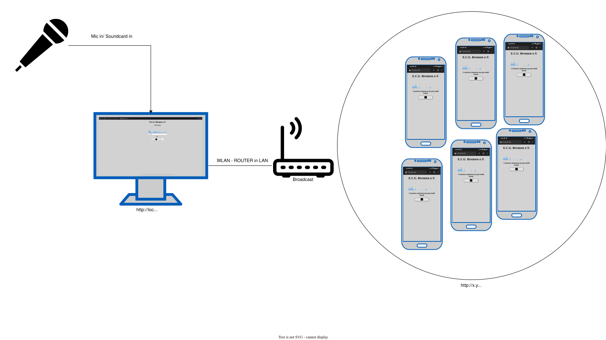

# Stream – live translation on your phone

With this program, listeners hear a translation (or any other audio) **live on their own phone** – no app needed, just the web browser. A computer picks up the sound (e.g. from the mixing desk or the translator's microphone) and sends it over Wi-Fi to all phones. The sound arrives **without noticeable delay**.

- For listeners: open the address, tap the big button, done.
- Several channels at once, e.g. "Russian" and "English".
- Listener texts in 14 languages: German, English, Russian, Ukrainian, Persian, Arabic, Hebrew, Turkish, Romanian, Polish, Spanish, French, Armenian, Georgian.
- Light and dark mode.
- Statistics: how many listeners were connected on average on which day?
- Works only in your own network (Wi-Fi/LAN). The internet is only needed for installation and updates.



---

## What you need

1. **A computer** that is running during the service / event (Windows 10/11, Mac or Linux).
2. **An audio source** connected to this computer: microphone, USB audio interface or a cable from the mixing desk.
3. **A Wi-Fi network** that the computer and the listeners' phones are connected to.

---

## Installation

The installation takes about 5 minutes. Afterwards the program starts **automatically** whenever the computer is switched on.

### Windows

1. Download the file [install-windows.cmd](https://raw.githubusercontent.com/ecg-media/stream/main/installer/install-windows.cmd) (right-click the link → "Save link as …").
2. Double-click the downloaded file.
3. If Windows shows a warning ("Windows protected your PC"): click **More info** → **Run anyway**.
4. Answer the question about administrator rights with **Yes**.
5. Wait until **"Fertig!"** (done) appears. The addresses for listeners and for the administration are shown there as well.

### Mac

1. Open the **Terminal** app (Spotlight: `⌘ + Space`, type "Terminal").
2. Paste this line and press Enter:
   ```bash
   curl -fsSL https://raw.githubusercontent.com/ecg-media/stream/main/installer/install.sh | sudo bash
   ```
3. Enter your Mac password (nothing is shown while typing – that is normal) and press Enter.
4. Wait until **"Fertig!"** (done) appears.

### Linux (Ubuntu, Debian, Fedora, Raspberry Pi OS …)

1. Open a terminal.
2. Paste this line and press Enter:
   ```bash
   curl -fsSL https://raw.githubusercontent.com/ecg-media/stream/main/installer/install.sh | sudo bash
   ```
3. Enter your password and wait until **"Fertig!"** (done) appears.

---

## Getting started

### 1. Open the administration

On the **computer where the program is installed**, open this address in the browser (Chrome, Edge, Firefox or Safari):

```
http://localhost/publish.html
```

> For security reasons, browsers allow sending **only directly on this computer**. Editing channels and viewing statistics also works from other devices (address `http://<IP address>/publish.html`).

### 2. Set up a channel

- Under **Channels** there is already a channel called "Übersetzung".
- With **Edit** you give it a name (e.g. "Russian translation") and choose the **spoken language**. Listeners then see all hints in this language.
- With **Add channel** (top right) you create more channels, e.g. for a second language.

### 3. Send

- Select the **audio source** for the channel (the first time, the browser asks whether it may access the microphone → **Allow**).
- If the sound comes by cable from the **mixing desk**, tick **"Mixing desk input"**. The browser then leaves the sound untouched (no echo or noise filters). Leave it unticked for a simple microphone.
- Tap **Start sending**. The coloured bar shows that sound is coming in.
- When you are finished, tap **Stop sending**.
- The administration page must **stay open** while sending.

### 4. Listen

Listeners open the address shown in the administration under the **gear icon at the top right (Settings) → Address for listeners** on their phone, e.g.:

```
http://192.168.1.20
```

and tap the **big button**. That's all. The rings around the button move with the sound.

> `localhost` only works on the server computer itself. Phones always need the address from the settings (the network address of the computer).

- If there is only **one channel**, the page opens that channel directly.
- If there are **several channels**, listeners choose their channel once. The phone remembers the choice for next time. **Change channel** (top right) switches at any time.
- If the broadcast has not started yet, the page says "please wait". As soon as sending starts, playback begins **automatically**.
- The button at the top right switches between **light and dark**.

> **Tip:** Print the address in large letters or turn it into a QR code (e.g. with a free QR code generator) that listeners only have to scan.

---

## Language and appearance of the administration

Use the **gear icon at the top right** to change the language of the administration (**Deutsch, Русский, English, Українська**) and to choose light or dark. The browser remembers the setting. The language of the listener page does not depend on it – it follows the language of the channel.

## Password for the administration (recommended)

Without a password, **anyone on the Wi-Fi** can open the administration. Use the **gear icon at the top right → Admin password** to set a password. After that you sign in to the administration once (the sign-in is remembered for 30 days). Listeners do **not** need a password. After 5 wrong attempts, signing in is blocked for one minute.

Forgot the password? See [Frequently asked questions](#frequently-asked-questions).

## Statistics

Under **Statistics** you see:

- how many listeners were connected **per day** on average (and the maximum),
- the average per **weekday** (Mon – Sun),
- a table with all days and the airtime.

A sample is taken **every minute while a channel is sending**. The average is given in **whole listeners** and is calculated only over the minutes in which at least one person was listening. So if one person listens, it shows "1" – even if the broadcast was running before. The airtime in the table is the whole time that was sent. You can view the statistics for all channels combined or for a single channel. Statistics are kept for **400 days**; older days are deleted automatically.

---

## Updating

Your channels, the password and the statistics are kept during an update.

- **Windows:** download [update-windows.cmd](https://raw.githubusercontent.com/ecg-media/stream/main/installer/update-windows.cmd) and double-click it – or simply run `install-windows.cmd` again.
- **Mac and Linux:** simply run the installation line again:
  ```bash
  curl -fsSL https://raw.githubusercontent.com/ecg-media/stream/main/installer/install.sh | sudo bash
  ```

## Uninstalling

- **Windows:** run `install-windows.cmd -Uninstall` in a command prompt.
- **Mac and Linux:**
  ```bash
  sudo bash /opt/ecg-stream/app/installer/install.sh --uninstall
  ```

---

## Frequently asked questions

**The phone cannot find the page.**
Is the phone on the **same Wi-Fi** as the computer (not mobile data / guest Wi-Fi)? Is the address correct (gear icon → Address for listeners)? `localhost` does not work on the phone.

**The page loads, but there is no sound.**
- Is a channel sending? In the administration the channel must show **"Live"**.
- Is the phone on silent or the volume all the way down?
- Some guest Wi-Fi networks prevent devices from talking to each other ("client isolation"). Use a different Wi-Fi in that case.

**"Start sending" is greyed out.**
The administration is not opened directly on the server computer at `http://localhost/publish.html`. Sending only works there (or over HTTPS, see below).

**The audio source is missing from the list.**
Connect the device and reload the page. The first time, microphone access must be allowed in the browser.

**All listeners should reload the page (e.g. after an update).**
In the administration, tap **Reload listeners** on the channel.

**Forgot the admin password.**
On the server computer:
- Windows (command prompt as administrator):
  ```bat
  sc stop EcgStream
  set DATA_DIR=%ProgramData%\ecg-stream
  "%ProgramFiles%\ecg-stream\node\node.exe" "%ProgramFiles%\ecg-stream\app\server\index.js" --set-password
  sc start EcgStream
  ```
- Linux:
  ```bash
  sudo systemctl stop ecg-stream && sudo -u ecg-stream DATA_DIR=/opt/ecg-stream/data /opt/ecg-stream/node/bin/node /opt/ecg-stream/app/server/index.js --set-password; sudo systemctl start ecg-stream
  ```
- Mac:
  ```bash
  sudo launchctl bootout system/media.ecg.stream; DATA_DIR=/opt/ecg-stream/data /opt/ecg-stream/node/bin/node /opt/ecg-stream/app/server/index.js --set-password; sudo launchctl bootstrap system /Library/LaunchDaemons/media.ecg.stream.plist
  ```
Leaving it empty and pressing Enter removes the password.

**Where do I find the log when there are problems?**
Windows: `C:\ProgramData\ecg-stream\server.log` · Linux: `journalctl -u ecg-stream` · Mac: `/var/log/ecg-stream.log`

---

## Advanced

### Settings during installation

| Setting | Default | Meaning |
|---|---|---|
| `PORT` | `80` | Port of the web page |
| `RTC_PORT` | `10000` | Port for the audio (UDP and TCP) |
| `IP` | automatic | IP address from which phones fetch the audio. Only set it if the automatic detection picks the wrong network adapter. |
| `DATA_DIR` | `data/` | Folder for channels, password and statistics |

Examples:

```bash
curl -fsSL https://raw.githubusercontent.com/ecg-media/stream/main/installer/install.sh | sudo PORT=8080 RTC_PORT=10002 IP=192.168.1.20 bash
```

```bat
install-windows.cmd -Port 8080 -RtcPort 10002 -Ip 192.168.1.20
```

To change the ports later, run the installer again with the new values. The installer opens the firewall for these ports (on Windows only for the local network). It sets up exactly one service; several instances on one computer are only possible with a manual start, each with its own `PORT`, `RTC_PORT` and `DATA_DIR` – with channels this is usually no longer necessary.

### Access from outside (reverse proxy)

The program is meant **only for local networks** and deliberately does not include HTTPS. If it should be reachable from outside or via HTTPS, put a reverse proxy (e.g. nginx, Caddy, Traefik) in front of it. Important:

- WebSockets must be forwarded (`/socket.io/`).
- The audio does **not** go through the proxy but directly via WebRTC over `RTC_PORT` (UDP/TCP). This port must be reachable for listeners, and `IP` must be the address that is reachable from there.
- Be sure to set an admin password.

Example for nginx:

```nginx
location / {
    proxy_pass http://127.0.0.1:80;
    proxy_http_version 1.1;
    proxy_set_header Upgrade $http_upgrade;
    proxy_set_header Connection "upgrade";
    proxy_set_header Host $host;
}
```

Over HTTPS, sending also works from other devices.

### Starting without the installer (developers)

Requirement: [Node.js](https://nodejs.org) 22 or newer.

```bash
npm ci
npm start
```

```bash
PORT=8080 RTC_PORT=10002 npm start
```

```bash
npm test
```

Technical details: [docs/architecture.md](docs/architecture.md).

## Credits

Originally based on the broadcast example from https://github.com/mganeko/mediasoup_v3_example/.
Icons: [Material Icons](https://github.com/google/material-design-icons) by Google (Apache License 2.0).
